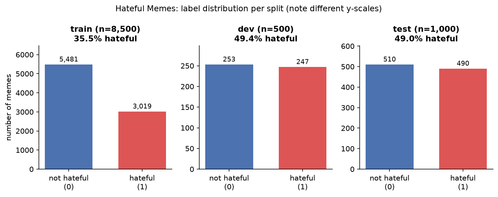
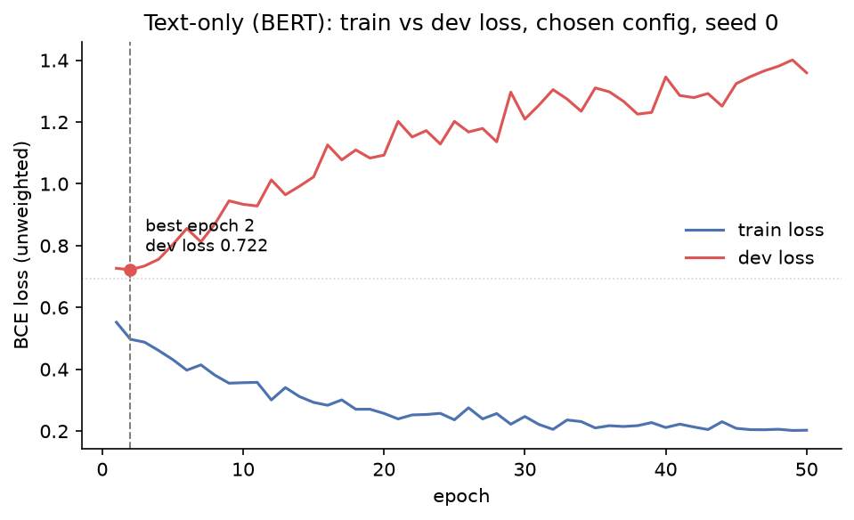
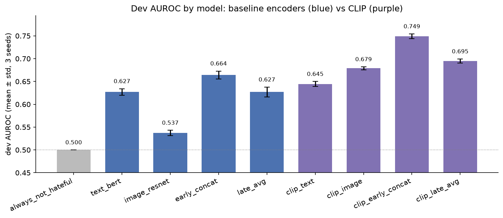
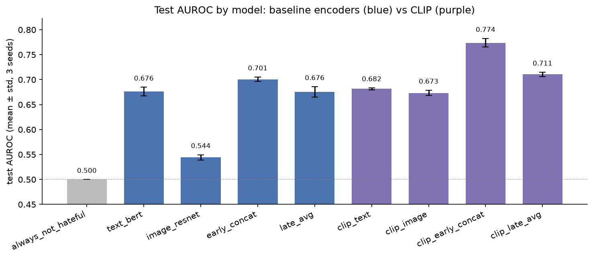
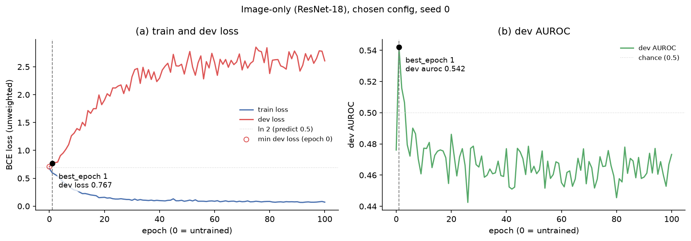
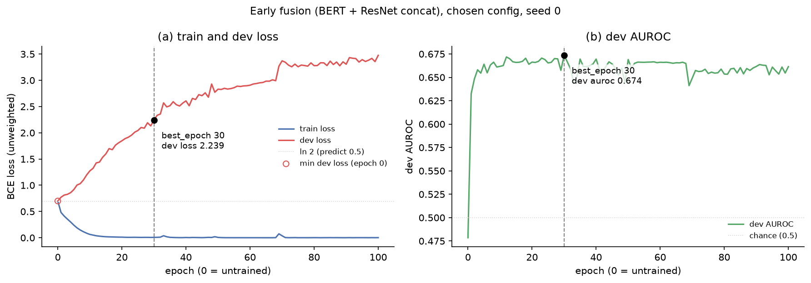
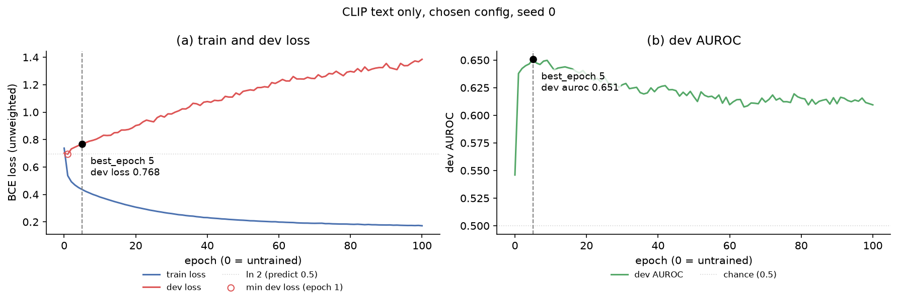
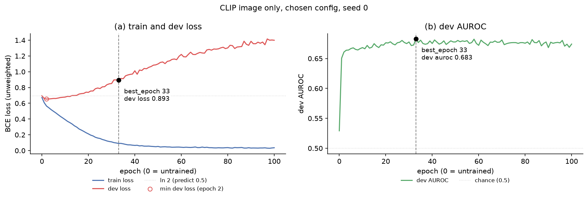
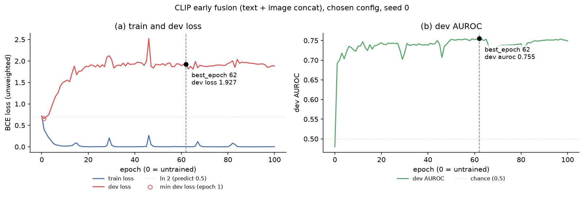

# ARI 510 Lab 3: Multimodal Classification with Pretrained Encoders

Roshkrishna Ranjith  
ARI 510  
UMID: 14584881

## 1. Looking at the Data

**Label distribution.** The training set has 8,500 memes, of which 35.5% are hateful. The dev (dev_seen) and test (test_seen) sets are much more balanced, at 49.4% of 500 and 49.0% of 1,000 respectively (Figure 1). This shift matters: a model trained on the training set learns that most memes are not hateful, so at a 0.5 threshold it will lean toward predicting "not hateful" on dev and test, which lowers recall. It also means accuracy alone is misleading, and I rely on AUROC as the primary metric because it does not depend on the threshold or the class balance.

*Figure 1: Label distribution per split: number of not-hateful and hateful memes, with % hateful (note the different y-scales).*

**Looking at examples.** I looked through 12 training memes (6 hateful, 6 not). The images were mostly cartoons, illustrations, and stock-style pictures, though some used real photos (e.g. id 06435) such as a child, a well-known film character, or animals, which were harmless on their own. The hateful memes typically ended in a punchline that carried the attack, mostly targeting Muslims and Black people, with one anti-feminist example (id 80945). The non-hateful memes were ordinary memes without that punchline structure. In most hateful examples, the image alone was neutral and the meaning only became hateful once paired with the text (e.g. id 58609). I agreed with every label in this sample, and none of the images were blurry or confusing.

**Being the model.** I labeled 20 randomly chosen dev memes without seeing their labels and reached 65% accuracy (13/20; precision 0.44, recall 0.67, F1 0.53). For each meme I also recorded which modality I needed: both image and text for 9, the image alone for 5, and the text alone for 6. I was right on 5 of 6 text-only and 4 of 5 image-only memes, but on only 4 of the 9 memes that needed both (44%), which is about chance. These are the confounder-style memes the dataset was designed around.

My errors fell into two groups. Five of the seven were false alarms: I reacted to a sensitive topic (Jewish people, the number six million, Muslims, Lebanon, drugs) rather than to an actual attack on a group. One (61085) I labeled hateful because it seemed to promote cocaine, which isn't hate under the dataset's definition. My two misses (89425, 23810) were the opposite problem: I could not understand the image or the reference in the text, which I believe depends on American cultural context I am not familiar with. One caveat is that my sample was only 30% hateful compared with 49% in the full dev set, and with 20 memes each error moves accuracy by 5 points, so 65% is a rough baseline. Even so, the task was clearly hard for me as a human, and it needs both world knowledge and careful reading of how the image and text combine.

## 2. Approach

**Encoders.** All encoders were used frozen (eval mode, no gradients) and embeddings were computed once on an RTX 5060 Laptop GPU and cached to disk (~5 minutes total). Text was encoded with bert-base-uncased, keeping the [CLS] vector from the last layer (768-d, max length 128). Images were encoded with ResNet-18 (ImageNet weights) with its final classification layer replaced by an identity, giving a 512-d vector per image. For the 510 design change I also encoded both modalities with CLIP ViT-B/32 (OpenAI weights, 512-d each). CLIP's first run warned that these weights expect the QuickGELU activation, which open_clip's default configuration does not use; I forced QuickGELU and recomputed, then checked that CLIP matches each meme's image to its own text 62–65% of the time among 200 candidates (0.5% by chance). Re-embedding a sample reproduced the cached vectors to within 2.5e-5.

**Why remove ResNet's final layer?** ResNet-18’s final layer maps the 512-number feature vector to scores for 1,000 ImageNet categories (dog, car, mushroom…). Those categories have nothing to do with hateful memes, so the scores would throw away most of the useful information. The 512-number vector before that layer is a general description of what’s in the image (objects, people, textures, layout), so we keep it and train our own classifier on top of it.

**Classifier and training.** Every model uses the same small feedforward network (Linear → ReLU → [dropout] → Linear to one logit) trained with BCEWithLogitsLoss, Adam, and mini-batches of 64, through a single shared training function. Features are standardized using statistics from the training set only. All choices were made on the dev set; the test set was not loaded until the final comparison.

**Hyperparameter selection.** For each model I searched hidden size {64, 256, 512}, learning rate {1e-3, 3e-4, 1e-4, 3e-5}, dropout {0, 0.3}, weight decay {0, 1e-4}, and pos_weight {none, n_neg/n_pos}, for up to 100 epochs, selecting by dev AUROC. The chosen configuration was retrained with 3 seeds and I report mean ± std. Chosen text-only config: hidden 64, lr 1e-3, dropout 0, weight decay 0, pos_weight ≈ 1.82 (n_neg/n_pos); best epoch 2 for all 3 seeds.

**Sanity checks (text model).** An always-"not hateful" baseline scores 0.506 accuracy and 0 F1 on dev. A freshly initialized network had a starting loss of 0.659, close to ln 2 ≈ 0.693. Trained on 20 examples, it reached 5e-5 training loss and 100% training accuracy, confirming the training loop works.

**Changes from the instructions.** My first runs stopped training at the epoch with the lowest dev loss. For all three seeds this was epoch 1–2, and the untrained network often had a lower dev loss than any trained epoch, even though dev AUROC rose from about 0.5 to 0.62. Dev loss was rising because the model overfits quickly and is miscalibrated for dev's 49% hateful rate after training on 35%. Since I select models by AUROC, I switched early stopping to the epoch with the highest dev AUROC (Figure 2). I also tried slower learning rates (down to 3e-5); they delayed the AUROC peak (to about epoch 19) but did not raise it, and in 68 of 96 runs the untrained model had the lowest dev loss. All 96 configurations fell between 0.620 and 0.635 AUROC, within seed noise. I also labeled 20 dev memes for the human baseline (the PDF says 10 in Part 0 and 20 in the checklist).

*Figure 2: Text-only (BERT [CLS]) model, chosen configuration, seed 0. (a) Train and dev loss per epoch (epoch 0 = untrained). (b) Dev AUROC per epoch. The dashed line marks best_epoch (highest dev AUROC).*

## 3. Results

All numbers are mean ± std over three training seeds (0, 1, 2) at the fixed 0.5 threshold; the always-"not hateful" baseline is a single deterministic run. Every configuration, epoch and threshold was chosen on dev (Table 1) before the test set was evaluated once (Table 2).

*Table 1: Dev (dev_seen, 500 memes) results.*

| model | accuracy | precision | recall | F1 | AUROC |
|---|---|---|---|---|---|
| always_not_hateful | 0.506 | 0.000 | 0.000 | 0.000 | 0.500 |
| text_bert | 0.574 ± 0.012 | 0.602 ± 0.016 | 0.408 ± 0.035 | 0.485 ± 0.027 | 0.627 ± 0.007 |
| image_resnet | 0.515 ± 0.001 | 0.569 ± 0.065 | 0.128 ± 0.098 | 0.194 ± 0.125 | 0.537 ± 0.006 |
| early_concat | 0.580 ± 0.014 | 0.663 ± 0.026 | 0.304 ± 0.021 | 0.416 ± 0.025 | 0.664 ± 0.009 |
| late_avg | 0.557 ± 0.010 | 0.639 ± 0.040 | 0.247 ± 0.067 | 0.352 ± 0.063 | 0.627 ± 0.011 |
| clip_text | 0.571 ± 0.006 | 0.661 ± 0.019 | 0.270 ± 0.002 | 0.383 ± 0.003 | 0.645 ± 0.005 |
| clip_image | 0.613 ± 0.005 | 0.660 ± 0.015 | 0.451 ± 0.052 | 0.534 ± 0.031 | 0.679 ± 0.003 |
| **clip_early_concat (510 design change)** | 0.671 ± 0.005 | 0.769 ± 0.033 | 0.480 ± 0.024 | 0.591 ± 0.009 | **0.749 ± 0.005** |
| clip_late_avg | 0.611 ± 0.012 | 0.700 ± 0.018 | 0.372 ± 0.018 | 0.486 ± 0.019 | 0.695 ± 0.005 |

*Figure 3: Dev AUROC by model (mean ± std over 3 seeds). Blue: BERT / ResNet-18 encoders; purple: CLIP ViT-B/32 encoders; grey: always-"not hateful" baseline.*

*Table 2: Test (test_seen, 1,000 memes) results, evaluated once.*

| model | accuracy | precision | recall | F1 | AUROC |
|---|---|---|---|---|---|
| always_not_hateful | 0.510 | 0.000 | 0.000 | 0.000 | 0.500 |
| text_bert | 0.616 ± 0.003 | 0.649 ± 0.025 | 0.475 ± 0.052 | 0.547 ± 0.026 | 0.676 ± 0.009 |
| image_resnet | 0.516 ± 0.002 | 0.533 ± 0.019 | 0.131 ± 0.102 | 0.196 ± 0.126 | 0.544 ± 0.005 |
| early_concat | 0.611 ± 0.006 | 0.692 ± 0.009 | 0.373 ± 0.025 | 0.485 ± 0.020 | 0.701 ± 0.005 |
| late_avg | 0.583 ± 0.014 | 0.674 ± 0.025 | 0.296 ± 0.085 | 0.406 ± 0.074 | 0.676 ± 0.010 |
| clip_text | 0.592 ± 0.007 | 0.667 ± 0.014 | 0.333 ± 0.014 | 0.444 ± 0.013 | 0.682 ± 0.002 |
| clip_image | 0.612 ± 0.007 | 0.665 ± 0.024 | 0.424 ± 0.036 | 0.516 ± 0.021 | 0.673 ± 0.005 |
| **clip_early_concat (510 design change)** | 0.681 ± 0.009 | 0.742 ± 0.016 | 0.536 ± 0.028 | 0.622 ± 0.017 | **0.774 ± 0.009** |
| clip_late_avg | 0.611 ± 0.004 | 0.702 ± 0.008 | 0.359 ± 0.007 | 0.475 ± 0.008 | 0.711 ± 0.004 |

*Figure 4: Test AUROC by model (mean ± std over 3 seeds), same models and colours as Figure 3.*

## 4. Discussion

**How useful are text and images?** With BERT and ResNet, text was clearly the more useful modality: text-only reached 0.676 test AUROC, while image-only reached 0.544, barely above the 0.500 of always predicting "not hateful". With CLIP the gap closed: CLIP image (0.673) and CLIP text (0.682) were nearly equal on test, and on dev the image model was actually ahead (0.679 vs 0.645). So my hypothesis that text is more useful held for BERT/ResNet but was really a statement about ResNet. ResNet was trained to recognize ImageNet objects, which says little about what a meme means. CLIP was trained on hundreds of millions of web image–text pairs, and since meme images contain their overlaid text, CLIP's image vector may also capture some of the text itself.

**Did fusion help, and which kind?** Early fusion helped for both encoder pairs: BERT+ResNet early fusion reached 0.701 test AUROC (+2.5 over text-only, within my predicted 2–5 points), and CLIP early fusion reached 0.774 (+9.2 over the best single CLIP model). Late fusion helped much less: for BERT/ResNet it added nothing over text-only (0.676 for both), since averaging in a near-chance image model only dilutes the text model's predictions. For CLIP it gave a modest gain (0.711). This fits how the dataset was built. The dev and test sets are dominated by multimodal hate and by benign confounders (80% of each set by construction), where the same text or image appears with a different partner and a different label; in dev, 78 of the 79 groups of memes sharing identical text contain both labels. A model that judges each modality separately, as late fusion does, cannot resolve these cases, while a classifier that sees both feature vectors together can at least learn simple interactions between them.

**Comparison with the original paper.** My frozen-encoder baselines land close to the fine-tuned baselines in Kiela et al. (2020, NeurIPS version): text-only 67.6 vs 69.0, late fusion 67.6 vs 69.3, and BERT+ResNet early fusion 70.1 vs Concat BERT's 67.8 in test AUROC. On dev, my text-only model was about 2.4 points lower than theirs (62.7 vs 65.05), so I would call these effectively equivalent, given that my dev and test numbers alone differ by about 5 points. My CLIP early fusion (77.4) exceeds the paper's best baseline, VisualBERT COCO (75.4), despite using frozen encoders and a small classifier. I attribute this to CLIP, which was released after the paper, rather than to my method: CLIP's large-scale image–text pretraining already provides much of the cross-modal alignment that VisualBERT gets from multimodal pretraining on the much smaller COCO dataset plus end-to-end fine-tuning.

*Table 3: AUROC (×100) compared with Kiela et al. (2020, NeurIPS version, Table 1). Paper test values are mean ± std over three seeds; paper dev values have no std. Ours are mean ± std over three seeds.*

| model | paper dev | ours dev | paper test | ours test |
|---|---|---|---|---|
| Image-only, grid features (paper: ResNet-152; ours: ResNet-18) | 52.33 | **53.7** | 53.71 ± 2.04 | **54.4 ± 0.5** |
| Image-only, region features (paper: Faster R-CNN) | 57.24 | — | 57.74 ± 0.73 | — |
| Text BERT | 65.05 | 62.7 | 69.00 ± 0.11 | 67.6 ± 0.9 |
| Late fusion | 65.07 | 62.7 | 69.30 ± 0.33 | 67.6 ± 1.0 |
| Concat BERT / our early fusion | 65.88 | **66.4** | 67.77 ± 0.87 | **70.1 ± 0.5** |
| Best paper model (Visual BERT COCO) | 74.14 | — | 75.44 ± 1.86 | — |
| CLIP early fusion (our 510 design change) | — | **74.9** | — | **77.4 ± 0.9** |

Bold marks where our model scored above the corresponding paper model. Our image-only model beat the paper's comparable ResNet grid-feature baseline on both splits (but not its stronger region-feature model), our early fusion beat Concat BERT on both splits, and CLIP early fusion beat the paper's best model on both splits. Our text-only and late-fusion models were slightly below the paper's.

**Comparison with the dumb baseline and with humans.** Every model except image-only ResNet clearly beats always predicting "not hateful" (0.510 test accuracy, 0 F1). My best model reaches 0.681 test accuracy, slightly above my own 65% on 20 dev memes, but my human baseline is far too small (20 memes, only 30% hateful) for a firm comparison. The paper's trained annotators reached 84.7% accuracy on the test set, well above every model here. My own errors were also telling: I failed on memes that needed both modalities (4 of 9 correct) and on memes that relied on cultural context I lacked, and these are exactly the cases where frozen encoders, which have no knowledge of memes or hate speech, are likely to fail too.

**What the frozen encoders tell us.** Neither BERT nor ResNet was ever trained on memes or hate speech, yet a small classifier on BERT's [CLS] vector reaches 0.68 AUROC. This shows that general language features already encode much of what makes text offensive. ResNet's ImageNet features, by contrast, carry almost no usable signal for this task: image-only dev AUROC even fell below 0.5 as training continued. Hyperparameters barely mattered: all 96 text configurations fell within 0.620–0.635 dev AUROC. The encoder, not the classifier, set the ceiling, which is why changing the encoder to CLIP was the change that mattered.

**Which metrics I relied on.** I relied on AUROC. The training set is 35% hateful while dev and test are about 49%, so models trained on train lean toward "not hateful" and their accuracy, recall and F1 at a 0.5 threshold mostly reflect that shift and whether pos_weight was used. For example, BERT+ResNet early fusion had a higher AUROC than text-only (0.701 vs 0.676) but a lower F1 (0.485 vs 0.547), because its chosen configuration did not use pos_weight and it predicted hateful too rarely. AUROC measures how well a model ranks hateful memes above non-hateful ones regardless of threshold, and it is the metric used by the original benchmark, so it is the fairest basis for comparing models.

## ARI 510: Hypothesis and Design Change

### Hypothesis (written before Part 3)

I wrote this hypothesis after Part 0 and the text-only model, before training any image-only or fusion model, and committed it to the repository at that point (`notes/hypothesis_510.md`).

*Evidence.* In the dev set, 78 of the 79 groups of memes that share identical text contain both a hateful and a non-hateful example. Text alone cannot separate them: any text-only model must get at least one meme wrong in each of those groups, which puts a hard ceiling on text-only performance. My own labeling points the same way: 9 of my 20 dev memes (45%) needed both the image and the text to judge, and I got only 4 of those 9 right.

1. **Single modality:** I expect text to be more useful on its own than images. When labeling, I found the text much easier to judge as hateful or not; images were often needed to confirm the meaning, but on their own they rarely decided it.
2. **Fusion:** I expect fusion to beat the best single-modality model, but only modestly, by roughly 2–5 AUROC points. The hateful meaning often lies in the combination of text and image, but BERT and ResNet were never trained on memes, and a small classifier on their frozen vectors can only learn simple interactions between them.
3. **Early vs. late fusion:** I expect early fusion to work better. It sees the text and image features together in one model, so it can in principle learn how they interact. Late fusion trains the two classifiers separately and only averages their verdicts, so each one still judges from a single modality and neither can catch a meme whose hatefulness exists only in the combination.

### Design change: CLIP encoders for both modalities

**Change.** I replaced BERT (text) and ResNet-18 (images) with CLIP ViT-B/32 (OpenAI weights), for both modalities, giving a 512-d text vector and a 512-d image vector per meme.

**Justification.** CLIP was trained on 400 million image–text pairs from the web, so its image and text vectors live in one shared space, and it has seen web images that contain text, like memes. ResNet-18 was trained only to recognize ImageNet object categories, and BERT only on books and Wikipedia. After the text-only and image-only results, the image encoder looked like the weakest link (ResNet image-only was barely above chance), and a fusion model can only combine what its encoders capture. So rather than changing how the two vectors are combined, I changed what the vectors contain, and kept everything else fixed so that any difference comes from the encoder.

**Setup.** Everything except the encoder is identical to the baseline: the same training function, the same 96-configuration grid, selection and early stopping by dev AUROC, and three seeds. I trained four CLIP models that mirror the baseline ones: text-only (`clip_text`), image-only (`clip_image`), early fusion on the concatenated 1,024-d vector (`clip_early_concat`, the design change), and late fusion averaging the seed-paired text and image probabilities (`clip_late_avg`). The chosen early-fusion configuration was hidden size 256, learning rate 1e-3, no dropout, weight decay 1e-4 and pos_weight ≈ 1.82 (best epochs 62, 27 and 90 for the three seeds).

### Results of the design change

AUROC, mean ± std over 3 seeds (all metrics are in Tables 1 and 2):

| model | BERT + ResNet, dev | CLIP, dev | BERT + ResNet, test | CLIP, test |
|---|---|---|---|---|
| text-only | 0.627 ± 0.007 | 0.645 ± 0.005 | 0.676 ± 0.009 | 0.682 ± 0.002 |
| image-only | 0.537 ± 0.006 | 0.679 ± 0.003 | 0.544 ± 0.005 | 0.673 ± 0.005 |
| early fusion | 0.664 ± 0.009 | **0.749 ± 0.005** | 0.701 ± 0.005 | **0.774 ± 0.009** |
| late fusion | 0.627 ± 0.011 | 0.695 ± 0.005 | 0.676 ± 0.010 | 0.711 ± 0.004 |

On dev, CLIP early fusion improved on the baseline early fusion by 0.085 AUROC (0.749 vs. 0.664), about ten times the larger seed std (0.009), and it was the best model on dev. It was then evaluated once on test, where it remained the best model: 0.774 vs. 0.701 for the baseline early fusion (+0.073), with the highest accuracy (0.681) and F1 (0.622) of all models as well. CLIP also improved late fusion (+0.068 on dev, +0.035 on test), but much less than early fusion.

### Hypothesis revisited

1. **Text more useful than images: held only for BERT/ResNet.** With the baseline encoders text clearly won (test 0.676 vs. 0.544). With CLIP the image model caught up: it beat CLIP text on dev (0.679 vs. 0.645) and was roughly level on test (0.673 vs. 0.682). My prediction was really about ResNet, not about images (see Section 4).
2. **Fusion helps by 2–5 points: held for BERT/ResNet early fusion, exceeded with CLIP.** Baseline early fusion beat the best single model by 3.7 points on dev and 2.5 on test, inside my range. With CLIP the gain was larger than I expected: 7.0 points on dev and 9.2 on test. Late fusion did not reach my range with BERT/ResNet (no gain on either split), because averaging in a near-chance image model adds nothing.
3. **Early fusion beats late fusion: held for both encoder pairs, on dev and on test** (BERT/ResNet: 0.664 vs. 0.627 dev, 0.701 vs. 0.676 test; CLIP: 0.749 vs. 0.695 dev, 0.774 vs. 0.711 test). This supports my reasoning that a classifier seeing both feature vectors together can learn how text and image combine, which averaging two separate verdicts cannot, though, as meme 57208 shows, this can also produce a hateful reading that isn't there.

## ARI 410: Look at the memes

### 410: meme 50379

**Fusion right, text-only wrong.** Label: not hateful. Text-only predicted hateful (p = 0.72); image-only (0.21), early fusion (0.0002) and late fusion (0.47) all predicted not hateful.

The text mentions a dishwasher. In hateful memes, "dishwasher" is a common anti-feminist slur for women, so the text-only model most likely read it as a sexist joke and predicted hateful. The image, however, shows an actual dishwasher, so the meme is literally about the appliance and is not hateful. The image resolves the ambiguity in the text, which is why both fusion models got it right and text-only did not.

### 410: meme 01967

**Fusion right, text-only wrong.** Label: not hateful. Text-only predicted hateful (p = 0.64); image-only (0.31), early fusion (0.007) and late fusion (0.48) all predicted not hateful.

The text (‘when you decide to stop racism by burning its symbol’) contains charged words like ‘racism’ and ‘burning’, which likely pushed the text-only model to predict hateful. The image shows a swastika being burned, so taken together the meme reads as a joke about destroying a racist symbol, not an attack on any group, and it is labeled not hateful. Both fusion models got it right, because the image supplies the context that the text alone lacks. The irony is that burning a swastika is itself a neo-Nazi rally ritual, so this meme is ambiguous even for a human.

### 410: meme 57208

**Early fusion wrong, both single models right.** Label: not hateful. Text-only (p = 0.44), image-only (0.46) and late fusion (0.45) all predicted not hateful; early fusion predicted hateful (0.77).

Taken separately, neither part of this meme is hateful: the text ("I had potato for lunch") is just a sentence about food, and the image is just a face shaped like a potato. The text-only and image-only models each saw only one of these harmless parts, so both correctly predicted not hateful. Early fusion, which sees text and image together, likely read the combination as mocking the potato-shaped person, an attack on someone's appearance, and predicted hateful. The meme is a light joke about the picture rather than an attack on anyone, so early fusion was wrong here: combining the modalities created a hateful reading that neither modality supports on its own.

## 5. Reflection

**1. Early stopping on dev loss didn't work.** At first I followed the lab's advice and stopped training at the lowest dev loss. When I looked at the curves for all three seeds, the stop always landed at epoch 1 or 2. Over the same stretch, dev AUROC kept climbing from about 0.50 to 0.62 while dev loss got worse. Across the full sweep, the untrained model had the lowest dev loss in 68 of 96 configurations. So the criterion was mostly choosing models that had learned nothing. I think two things were behind this. The model overfit within the first couple of epochs, and its probabilities were miscalibrated: the training set is 35.5% hateful but the dev set is 49.4%. That let the ranking of examples improve while cross-entropy loss went up. I tried lowering the learning rate, down to 3e-5, but that only pushed the AUROC peak out to around epoch 19 without raising it. In the end I switched to early stopping on dev AUROC, the metric the paper reports. I would make the same call again, because loss was measuring calibration rather than the ranking quality I actually cared about. Next time, though, I'd also fix the calibration directly by recalibrating on dev, for example tuning the decision threshold or rescaling the probabilities, instead of just changing the stopping metric.

**2. Being the model: 65% vs. 84.7%.** To get a sense of how hard the task is, I labeled 20 dev memes blind and got 13 right (65%). The paper's trained annotators reached 84.7% on the full test set. My sample was small and skewed (only 30% hateful, compared with 49% in dev), so the numbers don't line up exactly, but my errors were still revealing. Five of my seven mistakes were false alarms: I flagged memes because they touched a sensitive topic, even though they weren't attacking anyone. My two misses (89425 and 23810) depended on American cultural references I didn't know. On the memes that needed both the image and the text to interpret, I got only 4 of 9 right. This changed how I see the task. It isn't really about detecting offensive content in either modality. It's about recognizing intent, and that depends on cultural context that neither I nor a model trained on generic data reliably has. It also explains why unimodal baselines plateau: a sensitive topic in the text or the image predicts "hateful" only weakly.

**3. What I'd do differently.** I would start with CLIP. CLIP was trained on image–text pairs, whereas BERT saw only text and ResNet was trained to classify ImageNet objects, so CLIP is much closer to what this task needs. The results show it: image-only ResNet was close to chance (0.544 test AUROC), while CLIP's image features alone reached 0.673. I would also save every seed's model from the beginning. I had only saved seed 0, so before the test run I had to retrain seeds 1 and 2 (about 13 minutes). I also had to check that seed 0 reproduced bit-for-bit and that the dev predictions matched to within 3e-8. It worked out, but it was avoidable extra work right before the most important evaluation.

## 6. Generative AI Use Statement

| Phase | Used AI? | How (mode + what you asked) | How you checked / corrected / overrode it |
|---|---|---|---|
| Planning & understanding | Yes | Information + Advice. Asked Claude (chat) to read the lab PDF and starter notebook and summarize what ARI 510 requires. Had it split the lab into 7 steps and make me understand what the 7 steps to do were.Asked How to label memes under the dataset’s definition of hate. | Checked the plan against the PDF’s results checklist myself. Noticed the PDF says 10 human-labeled memes in Part 0 but 20 in the checklist, and chose 20. Kept the repo private and the dataset git-ignored. Decided myself to do the 410 analysis as an extra. |
| Coding and debugging | Yes | Creation. Claude Code (agentic, in VS Code) wrote all the code from my 7 step prompts: dataset download and verification, Part 0 plots and the blind-labeling sheet, cached BERT/ResNet/CLIP embeddings, the shared training function, the grid searches, the fusion models, the 410 disagreement analysis, and the single locked test evaluation. Advice: it flagged problems along the way (the CLIP QuickGELU mismatch, the pos_weight rounded in the CSV, seed models that weren’t saved). | Verified the split sizes and hateful % against the dataset, all 10,000 images present, the starting loss ≈ 0.69, the 20-example overfit at 100%, and that the test split was never loaded during training (git grep). From the per-seed curves, I found that early stopping on dev loss always picked epoch 1–2 while AUROC kept improving, and had it switch to stopping on AUROC. Checked that the pre-test tag came before the test run and that the evaluation script refused a second run.|
| Analysis & interpretation | Yes | Information + Advice. Asked Claude why ResNet’s final layer is removed, why dev loss rose while AUROC improved, how my results compare with Kiela et al. (2020) (V3).| Formed the hypothesis myself and committed it before Part 3. Labeled the 20 memes blind myself, and the 410 meme descriptions are my own. Claude’s paper numbers came from secondary sources and didn’t match v3 of the paper, so I had Claude Code read v3 Table 1 and used those numbers instead. |
| Report writing, formatting, editing | Yes | Advice / feedback. Gave Claude my own rough notes and had it polish the wording of the Part 0 notes, the hypothesis check, and drafts of the Data, Approach and Discussion sections. | Checked every number against the notebook and the results CSVs. Corrected Claude’s claims where they were wrong (e.g. the “text 2.5 points ahead” paper comparison). Rewrote the drafts in my own words(edited it). The Reflection is entirely my own writing. Claude only fact-checked my notes for it and did not write any of it. |

## Appendix: Training curves for every model

The text-only model's curves are Figure 2. Late fusion has no training, so it has no curves.

*Figure A1: Image-only (ResNet-18) model, chosen configuration, seed 0. (a) Train and dev loss per epoch (epoch 0 = untrained). (b) Dev AUROC per epoch. The dashed line marks best_epoch (highest dev AUROC).*

*Figure A2: Early fusion (BERT + ResNet-18 concatenation) model, chosen configuration, seed 0. (a) Train and dev loss per epoch (epoch 0 = untrained). (b) Dev AUROC per epoch. The dashed line marks best_epoch (highest dev AUROC).*

*Figure A3: CLIP text-only model, chosen configuration, seed 0. (a) Train and dev loss per epoch (epoch 0 = untrained). (b) Dev AUROC per epoch. The dashed line marks best_epoch (highest dev AUROC).*

*Figure A4: CLIP image-only model, chosen configuration, seed 0. (a) Train and dev loss per epoch (epoch 0 = untrained). (b) Dev AUROC per epoch. The dashed line marks best_epoch (highest dev AUROC).*

*Figure A5: CLIP early fusion (CLIP text + image concatenation) model, the 510 design change, chosen configuration, seed 0. (a) Train and dev loss per epoch (epoch 0 = untrained). (b) Dev AUROC per epoch. The dashed line marks best_epoch (highest dev AUROC).*
